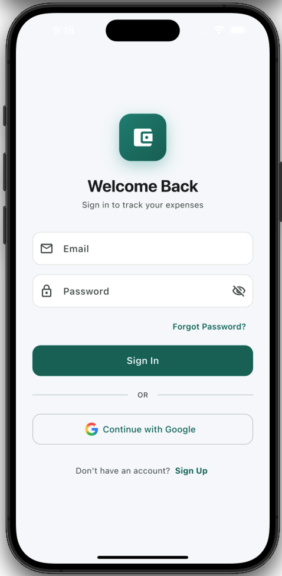
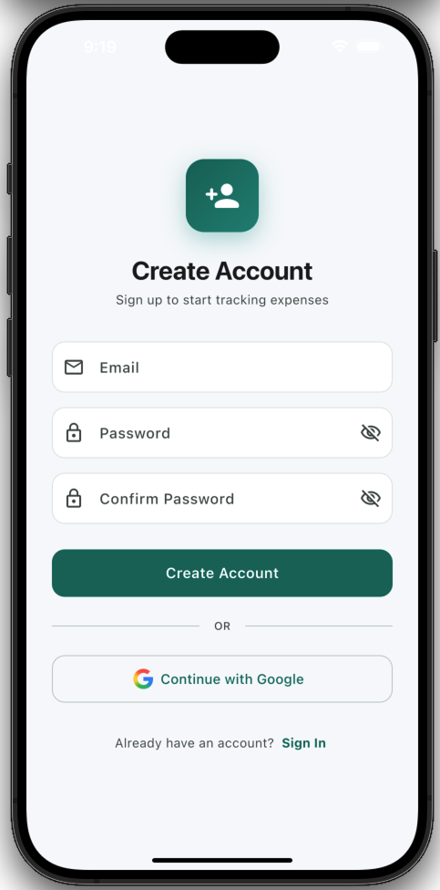
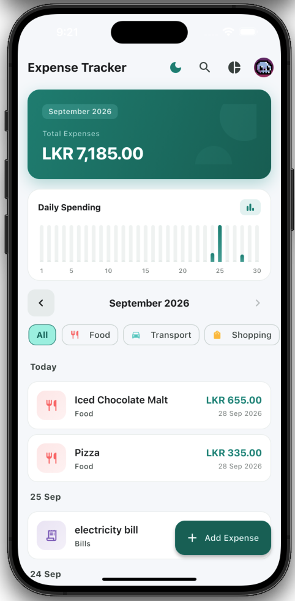
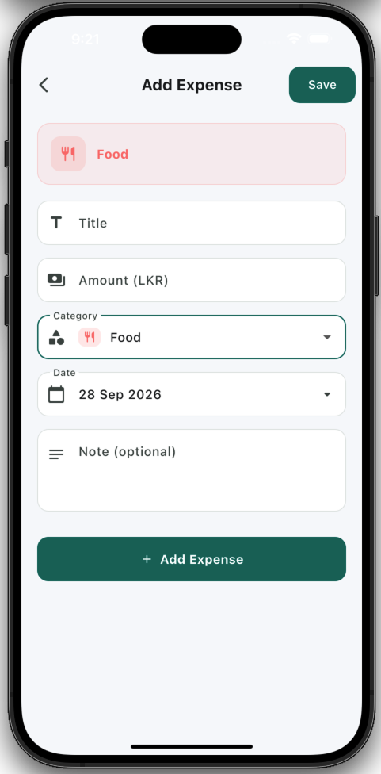
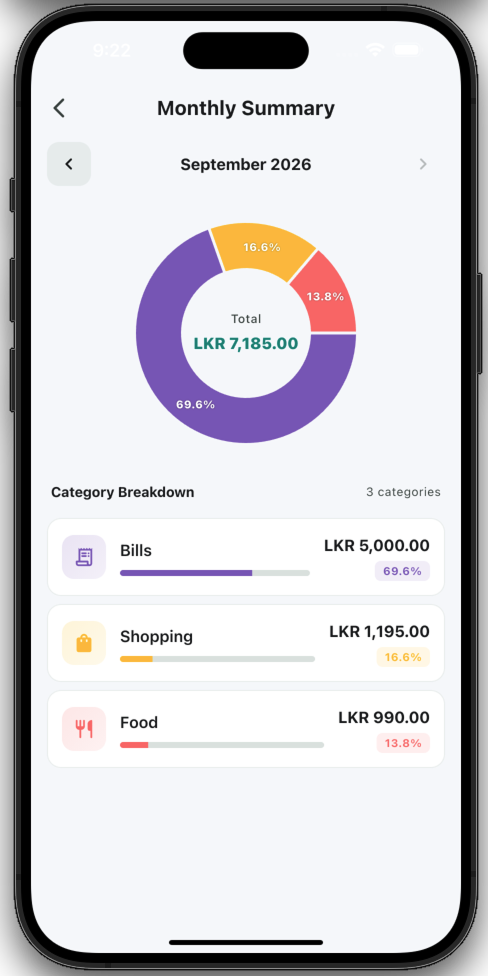
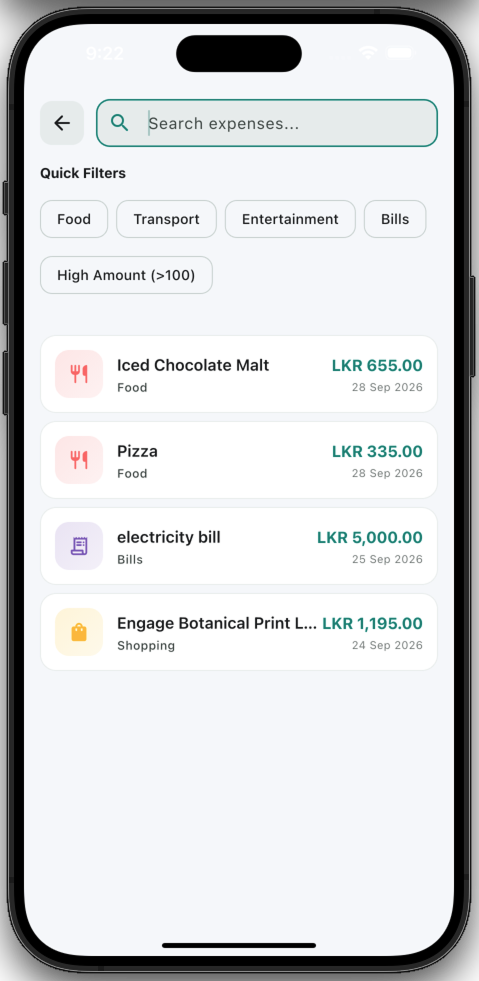

<div align="center">

# Expense Tracker

### A Feature-Rich Expense Management App Built with Flutter & Firebase

[](https://flutter.dev)
[](https://dart.dev)
[](https://firebase.google.com)
[](https://m3.material.io)
[](LICENSE)

> A polished, production-quality expense tracking application with Firebase Authentication, real-time Firestore data sync, interactive charts, dark mode, and a clean Material Design 3 interface.

**Submitted for:** CyphLab Flutter Developer Internship - Practical Task

</div>

---

## Screenshots

<div align="center">

|                                   Login                                   |                                    Register                                     |                             Home Dashboard                              |
| :-----------------------------------------------------------------------: | :-----------------------------------------------------------------------------: | :---------------------------------------------------------------------: |
|  |  |  |

|                                  Add / Edit Expense                                   |                                Monthly Summary                                |                                   Search                                    |
| :-----------------------------------------------------------------------------------: | :---------------------------------------------------------------------------: | :-------------------------------------------------------------------------: |
|  |  |  |

</div>

---

## Features

### ✅ Core Features (All Implemented)

| Feature                | Description                                                                                                                           |
| ---------------------- | ------------------------------------------------------------------------------------------------------------------------------------- |
| **Add Expense**        | Create new expenses with title, amount, category, date, and an optional note                                                          |
| **Edit Expense**       | Tap any expense to modify its details in a pre-filled form                                                                            |
| **Delete Expense**     | Swipe-to-dismiss or delete from the edit screen with confirmation                                                                     |
| **Category Selection** | 8 pre-defined categories: Food, Transport, Shopping, Bills, Entertainment, Health, Education, Other - each with unique icon and color |
| **Firebase Storage**   | All data stored in Cloud Firestore under per-user collections (`users/{uid}/expenses`)                                                |
| **Monthly Total**      | Summary card at the top of the dashboard showing the total spend for the selected month                                               |
| **Expense History**    | Date-grouped scrollable list with section headers (Today, Yesterday, or specific dates)                                               |
| **Filter by Category** | Horizontal chip-based category filter on the home screen                                                                              |
| **Filter by Date**     | Month selector with forward/backward navigation to browse any month                                                                   |
| **Form Validation**    | Comprehensive validation: required fields, valid email format, positive amounts, password strength, confirm-password match            |
| **State Management**   | Loading spinners, empty-state illustrations, and error messages with retry buttons - all handled gracefully                           |

### Additional Features (Bonus)

| Feature                        | Description                                                                                                               |
| ------------------------------ | ------------------------------------------------------------------------------------------------------------------------- |
| **Daily Expense Bar Chart**    | Interactive `fl_chart` bar graph on the home screen showing daily spending distribution for the selected month            |
| **Pie Chart Summary**          | Donut chart on the Summary screen with category-wise breakdown, percentages, and progress bars                            |
| **Dark Mode**                  | Full dark theme with deep navy palette (`#0F1729`) and vivid green accents (`#4ADE80`), togglable via the app bar         |
| **Monthly Category Summary**   | Detailed category breakdown with sorted list, progress indicators, and percentage badges                                  |
| **Search**                     | Full-text search across title, category, notes, and amount - plus quick-filter chips and an advanced `amount:>100` syntax |
| **Firebase Authentication**    | Email/password sign-up and sign-in with Google Sign-In (google_sign_in v7.x)                                              |
| **Forgot Password**            | Password reset flow that sends a Firebase reset email, with a success confirmation view                                   |
| **Theme Persistence**          | Theme preference saved with `shared_preferences` and restored on app restart                                              |
| **Pull-to-Refresh**            | Swipe down on the expense list to re-fetch data from Firestore                                                            |
| **Smooth Animations**          | Fade + slide transitions on every screen, elastic FAB entry, and animated theme toggle                                    |
| **Cupertino Page Transitions** | iOS-style page transitions on both Android and iOS for a native feel                                                      |

---

## Architecture & Project Structure

The project follows a **clean, layered architecture** with clear separation of concerns:

```
lib/
├── main.dart                      # App entry point, Firebase init, MultiProvider setup
│
├── models/
│   └── expense.dart               # Expense data model with Firestore serialization & copyWith
│
├── providers/                     # State management (ChangeNotifier + Provider)
│   ├── auth_provider.dart         # Auth state: sign-in, sign-up, sign-out, error handling
│   ├── expense_provider.dart      # Expense CRUD, month navigation, category filter, grouped data
│   └── theme_provider.dart        # Dark/light mode toggle with SharedPreferences persistence
│
├── services/                      # Data layer - Firebase interaction
│   ├── auth_service.dart          # Firebase Auth + Google Sign-In wrapper with error mapping
│   └── firestore_service.dart     # Firestore CRUD: per-user expense collection, month queries
│
├── screens/                       # UI layer - full-screen pages
│   ├── auth_wrapper.dart          # StreamBuilder on auth state → routes to Login or Home
│   ├── login_screen.dart          # Email/password login + Google Sign-In + forgot password link
│   ├── register_screen.dart       # Email/password registration + Google Sign-In
│   ├── forgot_password_screen.dart# Password reset form → success confirmation view
│   ├── home_screen.dart           # Dashboard: summary card, chart, month selector, filters, list
│   ├── add_edit_expense_screen.dart # Shared form for creating and editing expenses
│   ├── search_screen.dart         # Full-text search with quick filters + advanced amount syntax
│   └── summary_screen.dart        # Pie chart + category breakdown list with percentages
│
├── widgets/                       # Reusable UI components
│   ├── summary_card.dart          # Monthly total display card
│   ├── expense_bar_chart.dart     # Daily spending bar chart (fl_chart)
│   ├── month_selector.dart        # Month navigation with left/right arrows
│   ├── category_filter_chip.dart  # Horizontal scrollable category filter chips
│   └── expense_tile.dart          # Individual expense list item with dismiss-to-delete
│
└── utils/                         # Shared utilities
    ├── app_theme.dart             # Material 3 light + dark ThemeData definitions
    ├── constants.dart             # Category definitions (name, icon, color)
    └── formatters.dart            # Currency formatting (LKR), date formatting helpers
```

### Design Decisions

- **Provider Pattern** - Chosen for its simplicity and first-party Flutter support. Each domain (auth, expenses, theme) gets its own `ChangeNotifier`, keeping state isolated and testable.
- **Service Layer** - `AuthService` and `FirestoreService` encapsulate all Firebase calls, making it straightforward to swap backends or write unit tests with mocks.
- **Per-User Data Isolation** - Expenses are stored at `users/{uid}/expenses` in Firestore, ensuring complete data isolation between accounts.
- **Shared Add/Edit Screen** - A single `AddEditExpenseScreen` handles both creation and editing, reducing code duplication. The `expense` parameter being `null` determines the mode.
- **Material 3 Theming** - `ColorScheme.fromSeed()` generates a harmonious palette from brand colors. Both light and dark themes share the same component styling with theme-aware color choices.

---

## Tech Stack

| Layer                | Technology                 | Purpose                                       |
| -------------------- | -------------------------- | --------------------------------------------- |
| **Framework**        | Flutter 3.13 / Dart 3.13   | Cross-platform UI                             |
| **Backend**          | Firebase (Cloud Firestore) | Real-time NoSQL database for expense storage  |
| **Auth**             | Firebase Authentication    | Email/password + Google Sign-In               |
| **State Management** | Provider (v6.1)            | Reactive state management with ChangeNotifier |
| **Charts**           | fl_chart (v1.2)            | Interactive bar and pie charts                |
| **Date Formatting**  | intl (v0.20)               | Locale-aware date and currency formatting     |
| **ID Generation**    | uuid (v4.6)                | Unique expense document IDs                   |
| **Persistence**      | shared_preferences (v2.5)  | Local storage for theme preference            |
| **Google Sign-In**   | google_sign_in (v7.2)      | OAuth-based Google authentication             |
| **Design System**    | Material Design 3          | Modern, accessible UI components              |

---

## Expense Data Model

Each expense document stored in Firestore has the following structure:

```dart
class Expense {
  final String id;          // Unique identifier (UUID v4)
  final String title;       // e.g. "Groceries"
  final double amount;      // e.g. 2500.00 (in LKR)
  final String category;    // e.g. "Food", "Transport", "Shopping"
  final DateTime date;      // Expense date (selected via date picker)
  final String? note;       // Optional description
  final DateTime createdAt; // Auto-set timestamp
}
```

**Firestore path:** `users/{uid}/expenses/{expenseId}`

---

## Getting Started

### Prerequisites

- **Flutter SDK** ≥ 3.13.0 - [Install Flutter](https://docs.flutter.dev/get-started/install)
- **Firebase CLI** - [Install Firebase CLI](https://firebase.google.com/docs/cli)
- **A Firebase project** with Firestore and Authentication enabled

### Installation

```bash
# 1. Clone the repository
git clone https://github.com/<your-username>/expense_tracker.git
cd expense_tracker

# 2. Install dependencies
flutter pub get

# 3. Configure Firebase (if starting fresh)
#    This project already includes firebase_options.dart for my Firebase project.
#    To use your own Firebase project:
flutterfire configure

# 4. Enable Authentication providers in Firebase Console:
#    - Email/Password
#    - Google Sign-In

# 5. Run the app
flutter run
```

### Firebase Setup Notes

1. **Firestore Rules** - The app uses per-user collections. Ensure your Firestore rules allow authenticated users to read/write their own data:

   ```
   rules_version = '2';
   service cloud.firestore {
     match /databases/{database}/documents {
       match /users/{userId}/expenses/{expenseId} {
         allow read, write: if request.auth != null && request.auth.uid == userId;
       }
     }
   }
   ```

2. **Firestore Index** - If you see an index error, create a composite index on:
   - Collection: `expenses` (under `users/{uid}`)
   - Fields: `date` (Ascending), `category` (Ascending)

---

## How the App Works

### Authentication Flow

1. User opens the app → `AuthWrapper` listens to Firebase auth state
2. If not signed in → **Login Screen** (email/password or Google)
3. If new user → **Register Screen** with email validation and password confirmation
4. Forgot password → sends a Firebase reset email with a success confirmation UI
5. Once authenticated → automatically navigates to **Home Screen**

### Expense Management Flow

1. **Home Screen** loads expenses for the current month from Firestore
2. User can navigate months, filter by category, or search across all time
3. **Add Expense** → fill in title, amount, category, date, and optional note → saved to Firestore
4. **Edit Expense** → tap any expense tile → pre-filled form → update in Firestore
5. **Delete Expense** → swipe to dismiss with undo snackbar, or delete from edit screen

### Analytics Flow

1. **Daily Bar Chart** on the home screen shows spending distribution per day
2. **Summary Screen** shows a pie chart with category percentages
3. Category breakdown list with progress bars, sorted by amount descending

---

## AI Tools Used

| Tool                                | How It Helped                                                                                                                                            |
| ----------------------------------- | -------------------------------------------------------------------------------------------------------------------------------------------------------- |
| **Google Gemini (Antigravity IDE)** | Architecture guidance, code generation for boilerplate (Firebase services, Provider setup), debugging Firestore query issues, and generating this README |
| **GitHub Copilot**                  | Inline code completions for repetitive widget patterns and form validation logic                                                                         |

### My Approach to Using AI

I used AI tools as a **productivity accelerator**, not as a black box. Every piece of generated code was:

- **Reviewed and understood** before integration
- **Modified and adapted** to fit the project's specific architecture and design patterns
- **Debugged manually** when issues arose - particularly around Google Sign-In v7.x API changes and Firestore composite index requirements

I can fully explain every line of code in this project, the reasoning behind architectural decisions, and how each feature interacts with Firebase.

---

## Requirements Checklist

### Core Requirements

| #   | Requirement                                       | Status                        |
| --- | ------------------------------------------------- | ----------------------------- |
| 1   | Add new expenses                                  | ✅                            |
| 2   | Edit existing expenses                            | ✅                            |
| 3   | Delete expenses                                   | ✅                            |
| 4   | Select an expense category                        | ✅ 8 categories with icons    |
| 5   | Store expenses using Firebase                     | ✅ Cloud Firestore            |
| 6   | Display total expenses for current/selected month | ✅ Summary card               |
| 7   | Show expense history/list                         | ✅ Date-grouped list          |
| 8   | Filter expenses by category or date               | ✅ Category chips + month nav |
| 9   | Include proper form validation                    | ✅ All fields validated       |
| 10  | Handle loading, empty, and error states           | ✅ All three states handled   |

### Expense Fields

| Field                     | Status            |
| ------------------------- | ----------------- |
| Title                     | ✅                |
| Amount                    | ✅ (LKR currency) |
| Category                  | ✅ (8 predefined) |
| Date                      | ✅ (Date picker)  |
| Optional note/description | ✅                |

### Additional Features

| Feature                       | Status                                          |
| ----------------------------- | ----------------------------------------------- |
| Simple expense chart          | ✅ Bar chart + Pie chart                        |
| Dark mode                     | ✅ Full theme with persistence                  |
| Monthly/category-wise summary | ✅ Dedicated summary screen                     |
| Search functionality          | ✅ Full-text + quick filters                    |
| Firebase Authentication       | ✅ Email + Google Sign-In                       |
| Other useful features         | ✅ Forgot password, pull-to-refresh, animations |

---

## About the Developer

I'm a software engineer with **4 years of professional experience** working as a **Senior Software Engineer (SSE)**. My background includes building and shipping production applications, working with complex architectures, and leading feature development across multiple platforms.

For this project, I challenged myself to learn Flutter from scratch through a crash course and built this complete application within a focused sprint. While Flutter was new to me, the underlying principles - state management, component architecture, service layers, and clean code practices - are concepts I've applied extensively throughout my career.

### What I Bring to the Table

- **Strong software engineering fundamentals** - Clean architecture, separation of concerns, proper error handling
- **Rapid technology adoption** - Learned Flutter and delivered a polished, feature-complete app in a very short timeframe
- **Production mindset** - Proper state management, user feedback for every action, graceful error handling, and thoughtful UX
- **Firebase expertise** - Real-time data sync, per-user data isolation, composite queries, and secure auth flows
- **Attention to detail** - Custom theme system, smooth animations, consistent design language, and responsive layouts

I'm genuinely excited about the opportunity at CyphLab and look forward to contributing with the depth of experience and the speed of learning I've demonstrated through this project.

---

## License

This project is built as a practical assessment submission for CyphLab.

---

<div align="center">

**Built with ❤️ using Flutter & Firebase**

</div>
